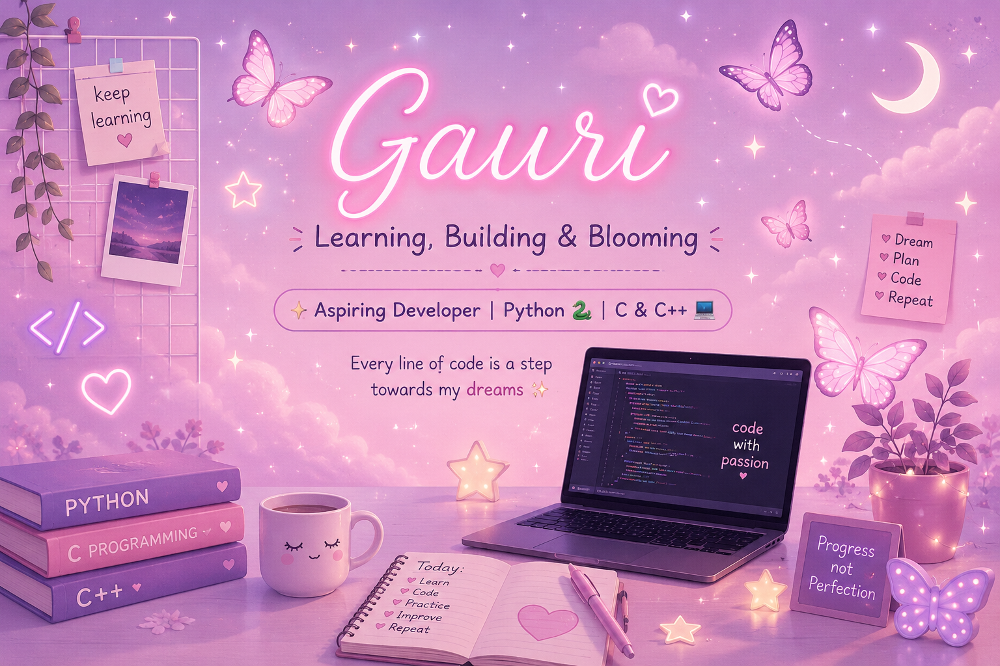

  

 

# 🎀 Hey there! I'm Gauri 💗

### 🌸 Aspiring Developer | Python 🐍 | C & C++ 💻

💗 ─────────────── 🌷 ─────────────── 💗

## 🎀 About Me

- 🌸 Hi! I'm Gauri, an aspiring programmer.
- 🐍 Currently learning Python.
- 💻 Exploring C and C++.
- 🌱 Improving my problem-solving skills.
- ✨ I enjoy learning new things and building projects.
- 🎯 My goal is to become a better developer every day.

## 🩷 My Tech Stack

## 🌷 Currently Working On

- 🐍 Practicing Python programming.
- 💻 Learning C and C++ fundamentals.
- 🧩 Solving beginner coding problems.
- 🌸 Building my first coding projects.

## 📊 My GitHub Journey

 

## 💌 Let's Connect!

🌸 Thanks for visiting my profile! 🌸

**Keep learning • Keep growing • Keep coding**

💗 Made with love, curiosity, and a little bit of pink! 🎀

